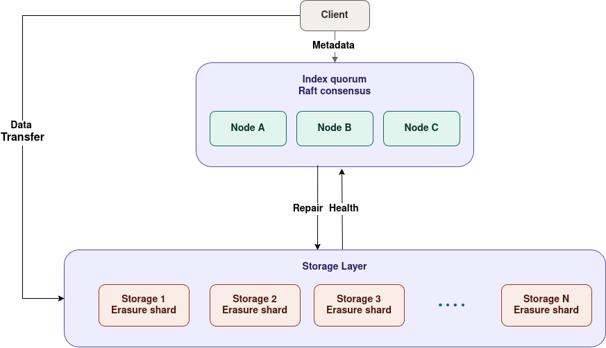

# Arkel

[Arkel](https://arkeldata.com) is object storage pooled together by the community. It aims to serve as a reliable Object store alternative to Cloud Corporations. 
* Designed around decentralized ideas.
* Open Source 
* Community powered storage
* Economy for storage operators

Read more: https://arkeldata.com/introduction

## Architecture



Full design: [architecture overview](https://arkeldata.com/architecture/overview).

## Install

```sh
curl -fsSL https://arkeldata.com/install.sh | sh
arkel --help```

## Quickstart

## As an operator — run a storage node

First, get your account id — your storage earnings are credited to it:

```sh
arkel identity
# prints: account: <your-account-id>
```

Then run the node (swap in your public IP, the disk you're committing, and the
account id from above):

```sh
docker run -d --name arkel-storage --restart unless-stopped --network host \
  -v arkel-data:/var/lib/arkel \
  ghcr.io/amr8t/arkel:latest storage \
  --addr 0.0.0.0:9001 \
  --advertise-addr <your-public-ip>:9001 \
  --index-addrs http://index.pc1.arkeldata.com:8001 \
  --data-dir /var/lib/arkel/storage-9001 \
  --earn-account <your-account-id> \
  --capacity 50GB
```

Or use the Compose example in [`examples/storage-node/`](examples/storage-node):
set `earn_account = "<your-account-id>"` in `arkel-node.toml`, then
`docker compose up -d`.
Full guide: https://arkeldata.com/quickstart

## As a user

```sh
# The public index cluster
INDEX=http://index.pc1.arkeldata.com:8001

# put
arkel client put photo.jpg --bucket media --key holidays/1.jpg --index-addrs "$INDEX"

# get
arkel client get media holidays/1.jpg --output photo.jpg --index-addrs "$INDEX"

# rm
arkel client rm media holidays/1.jpg --index-addrs "$INDEX"
```

Erasure coding means the network survives node failures — no single node holds
your data in the clear, and your data is encrypted before it leaves your
machine.


## Identity

Every command auto-creates an iroh keypair on first run and stores it as
`identity.key` in its data directory — no manual key generation. There are four
identities: client/user, storage node, payment operator, and repair operator.

```sh
arkel identity   # print your account id + key path
```

- The **client identity is your encryption key** — back it up, losing it loses
  your data.
- A storage node earns its contribution grant on its own identity by default;
  point it at your user account with `--earn-account <hex-pubkey>` to earn on
  the account you spend from.

Full details: https://arkeldata.com/identity


## License

AGPL-3.0. See [LICENSE](LICENSE).
